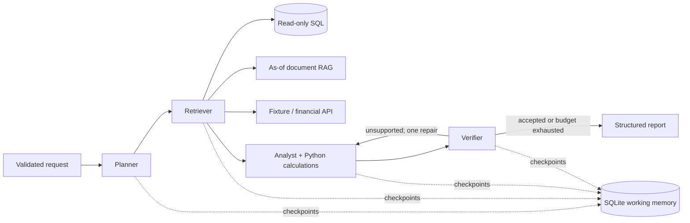

# FinAgent — Multi-Agent Financial Research & Decision System

[](https://github.com/jituslpl-dev/finagent/actions/workflows/quality.yml)

A four-role **LangGraph** workflow that plans a research question, retrieves SQL/document/market evidence, calculates financial metrics, and verifies the resulting report. SQLite checkpoints persist the complete working state across interrupted runs. Reports expose evidence, calculations, tool attempts, limitations and verification decisions rather than returning an unsupported investment recommendation.

**Python 3.12 · LangGraph · SQLite · TF-IDF RAG · Pydantic · HTTPX · LLM APIs · FastAPI · Docker**

## Resume claims and implementation

| Original claim | Concrete implementation |
|---|---|
| Planner, retriever, analyst, verifier | Four LangGraph nodes with a conditional verifier → analyst repair edge |
| Structured persistent working memory | Typed graph state and SQLite checkpoints storing request, plan, evidence, calculations, findings, tool events and trajectory |
| SQL querying | Read-only SQLite connection and parameterized, allowlisted fundamental-data query |
| Document retrieval / RAG | Symbol/date-filtered TF-IDF retrieval; analyst composes an evidence-backed report from retrieved quotes and computed metrics |
| Financial APIs | Alpha Vantage daily-close adapter with validated price output, as-of filtering and transient-error retries |
| LLM APIs | Optional Chat Completions planner and analyst, JSON output plus local Pydantic validation and bounded schema repair |
| Dynamic tool selection | Validated plans select SQL, documents and/or market tools according to the question |
| Retry and schema validation | Bounded exponential retries; tool allowlists, strict IDs/limits, forbidden extra fields and finite metric values |
| Quantitative evaluation suite | Hand-authored gold tasks for arithmetic, routing, citations, temporal eligibility, acceptance/abstention and local latency |

The default **offline** mode uses deterministic planner/analyst implementations with the same real LangGraph orchestration. It requires no credentials and makes no LLM calls. The optional **llm** mode replaces those two roles through a provider interface; retriever tools and quantitative verification remain bounded application code. Four roles does not mean four independent LLM calls.

## Architecture



The verifier checks scope, source availability dates, numerical reconciliation, exact evidence support and tool coverage. A report whose evidence is incomplete or whose ratios are undefined is returned with `accepted=false` and explicit issues after at most two analyst attempts. Acceptance means the bounded research checks passed; it is not a buy/sell decision.

## Quick start

From the repository root, create a Python 3.12 environment:

```bash
python -m venv .venv
# Linux/macOS: source .venv/bin/activate
# PowerShell: .venv\Scripts\Activate.ps1
python -m pip install -r requirements-lock.txt -r requirements-dev.txt
python -m pip install --no-deps -e .
finagent research --output reports/demo.json
finagent benchmark --output reports/benchmark.json
```

The default question compares fictional ALFA and BETA. ALFA has 25% annual revenue growth, a 20% operating margin, a 0.5 debt/equity ratio and USD 22 million free cash flow. BETA has -10% growth, a 5% margin, a 1.5 ratio and USD 6 million free cash flow. These are intentionally fictional fixtures, not current company financials. `runtime/` contains generated fixtures and persistent memory and is excluded from Git.

```bash
finagent research --symbols ALFA --as-of 2025-03-05 \
  --question "Analyze operating margin and risk factors" --thread example
finagent memory --thread example
```

Thread IDs are unique, bounded identifiers. Reusing one for a new request fails rather than overwriting its evidence.

## Durable interruption and resume

```bash
finagent research --thread restart-demo --pause
# Close the process. Start another process against the same directory:
finagent memory --thread restart-demo
finagent resume --thread restart-demo
```

`--pause` checkpoints after retrieval. Resume continues at the analyst using the saved request, plan and evidence. Completed resume is idempotent. State history exposes checkpoint count and pending nodes. API requests are serialized through a process lock for the single SQLite connection; this is a single-process deployment design.

## Optional LLM and financial API modes

Set `LLM_API_KEY` and an explicit `LLM_MODEL` supporting Chat Completions JSON mode in your environment, then:

```bash
finagent research --mode llm --symbols ALFA --as-of 2025-03-05 \
  --question "Analyze operating margin and risk factors"
```

For interrupted LLM runs, use the same `--mode llm` when resuming. JSON mode ensures a JSON response, while **local Pydantic validation** enforces the application's schema. Invalid schema output receives one repair request. A refusal, incomplete response or exhausted retry budget surfaces as a failure rather than silently replacing the model with an offline response. Usage totals expose provider-reported prompt/completion tokens and returned calls; no monetary cost estimate is invented.

The analyst selects exact supported quotes and calculation statements. It cannot add uncited numbers or arbitrary narrative claims. Retrieved documents are passed as untrusted evidence and cannot authorize extra tools or arbitrary SQL.

Set `ALPHA_VANTAGE_API_KEY`, then use `--live-market` for real provider requests:

```bash
finagent research --live-market --symbols IBM --as-of 2026-10-09 \
  --question "Retrieve daily close price"
```

Use an as-of date within the provider's returned compact daily history. Prices are unadjusted closes; this endpoint does not establish the quote currency, so live findings explicitly label it unspecified. Eligibility uses the trading date, not a historical point-in-time vendor snapshot; corporate actions, revisions and exchange currencies require a richer adapter for investment-grade research. Fixture fundamentals/documents cover ALFA/BETA/ZERO only: enabling a live quote does not replace them with real company fundamentals.

API integration is covered by mocked HTTP contract tests. Checked-in benchmark results use offline fictional data. No paid LLM invocation or authenticated live provider benchmark is claimed.

## Research API and container

Generate a random ASCII key of at least 16 characters and set `FINAGENT_API_KEY`. The API starts in reproducible offline mode:

```bash
uvicorn finagent.api:create_app --factory --host 127.0.0.1 --port 8000 --workers 1
# Or, with FINAGENT_API_KEY in the environment:
docker compose up --build
```

| Endpoint | Authentication | Behavior |
|---|---|---|
| `GET /health` | Public | Readiness, version and offline mode |
| `POST /research` | `X-API-Key` | Validated question/symbols/as-of; new persistent research thread |
| `GET /memory/{thread}` | `X-API-Key` | Saved state, pending nodes and checkpoint count |

```bash
curl -X POST http://127.0.0.1:8000/research \
  -H "Content-Type: application/json" -H "X-API-Key: YOUR_RANDOM_SECRET" \
  -d '{"question":"Analyze revenue growth and risk factors","symbols":["ALFA"],"as_of":"2025-03-05"}'
```

The image runs as UID 10001. Compose uses a read-only root filesystem, a persistent `/data` volume, temporary `/tmp`, dropped Linux capabilities, no-new-privileges and localhost binding. Missing API credentials fail startup. Credentials stay in environment/configuration, outside graph state. This shared-key API is a local portfolio service; it does not implement tenant isolation, identity-aware authorization or distributed checkpoint scaling.

## Evaluation and reproducibility

[Gold tasks](benchmarks/cases.json), [benchmark output](reports/benchmark.json) and [example report](reports/demo.json) are executable evidence. The gold suite has **26 cases**, including negative growth, two-company comparison, zero denominators, unknown symbols, a missing prior year, future quote exclusion and early-period financials.

The checked-in run passes **26/26 cases**, with 100% routing and acceptance/abstention agreement, zero numerical error against the finite gold values, and zero as-of violations. The local test suite passes **20 tests with 93.9% statement coverage**; see [coverage evidence](reports/test_coverage.json).

The benchmark records pass rate, tool-routing accuracy, acceptance/abstention accuracy, citation-reference validity, numerical MAE/RMSE/max error and temporal violations. Citation-reference validity checks identifiers, while runtime verification also requires exact allowed quote/calculation support. Neither is an unrestricted semantic fact-checking benchmark. Offline routing is deliberately bounded; these fixtures do not demonstrate general natural-language understanding or live LLM reasoning quality.

```bash
ruff check src tests scripts
ruff format --check src tests scripts
python -m pytest -q --cov=finagent --cov-report=term-missing
```

Tests exercise graph trajectories, restart/resume, bounded repair, SQL injection resistance, temporal retrieval, fabricated citations/numbers, API authorization, financial-provider rate limits, invalid prices, JSON-schema repair, incomplete LLM output and independent gold numerical answers. Windows/Linux CI runs tests, benchmarks and the CLI demo. A separate container job exercises real HTTP readiness, research, persistent memory and unauthorized rejection.

## Organization and design patterns

```text
src/finagent/
  schemas.py      Pydantic request/plan/evidence/report contracts
  agents.py       four focused role implementations
  workflow.py     LangGraph state, checkpoints, routing and resume
  tools.py        SQL, lexical RAG and financial provider adapters
  quant.py        deterministic financial calculations
  llm.py          structured model Protocol and HTTP adapter
  retry.py        immutable retry policy and transient error types
  factory.py      dependency composition and resource ownership
  evaluation.py  numerical/routing/abstention benchmark
  cli.py          demo, memory, resume and benchmark commands
  api.py          authenticated application factory/lifespan
benchmarks/       independent gold tasks
tests/            workflow and failure-path tests
docs/             methodology, operations and interview guide
reports/          aggregate evaluation and fictional example output
```

`ResearchTool` and `StructuredModel` are Protocol contracts. Adapter classes isolate providers; planner/analyst model strategies can be replaced independently. The composition root injects dependencies into the graph. Dataclasses give roles focused responsibilities; the frozen retry policy validates bounded budgets; Pydantic contracts establish boundaries. App-factory/lifespan and context managers own SQLite/HTTP resources. The graph expresses a state machine rather than hidden nested loops.

## Scope and further work

SQL is limited to a useful, safe fundamental-data query template; there is no arbitrary text-to-SQL execution. RAG is lexical TF-IDF with extractive findings, not a dense semantic embedding retriever. Evidence dates use published/available dates for fixtures, but live market data can be revised. The verifier shares the calculation function with the analyst, so independently authored benchmark answers are needed to catch formula errors. The repair loop fixes analyst selections; missing provider data requires a later run with better sources.

SQLite memory is plaintext trusted application state; protect it as research data. User-owned source files can replace the fixture database/documents using the documented schema, but need validation and provenance before use. Real deployments need source ingestion, independent LLM evaluation, access control, secrets management, TLS, observability, concurrency testing and a production checkpoint store.

See [methodology](docs/methodology.md), [operations](docs/operations.md) and [interview guide](docs/interview-guide.md).

## Official references

- [LangGraph persistence](https://docs.langchain.com/oss/python/langgraph/persistence) and [SQLite saver](https://reference.langchain.com/python/langgraph.checkpoint.sqlite)
- [OpenAI structured output and JSON-mode distinction](https://developers.openai.com/api/docs/guides/structured-outputs?api-mode=chat)
- [Alpha Vantage daily-series API](https://www.alphavantage.co/documentation/#daily)

## Resume wording

The original bullets map to the implementations above. A more specific version is:

> Built a four-role LangGraph financial research workflow with SQLite checkpointed working memory, parameterized SQL, as-of document RAG and financial/LLM API adapters. Added bounded tool/schema retries, citation and arithmetic verification, interruption recovery, and a reproducible gold-answer benchmark suite.
